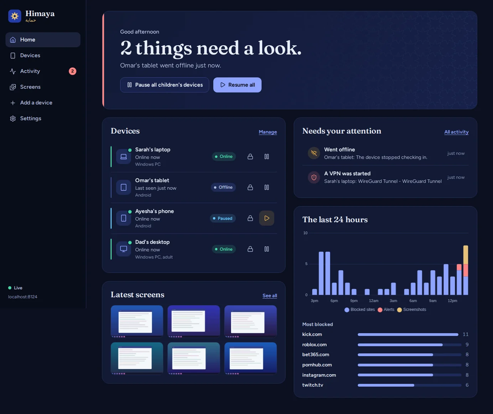
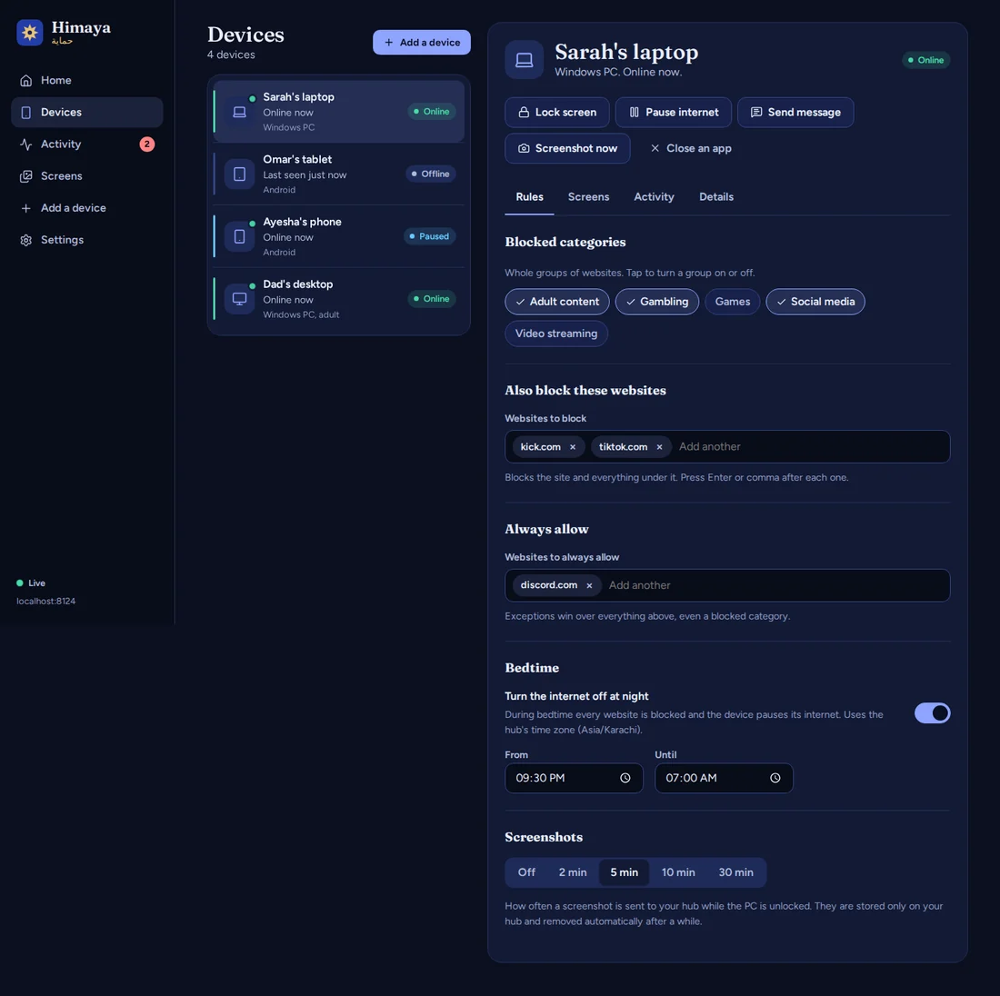
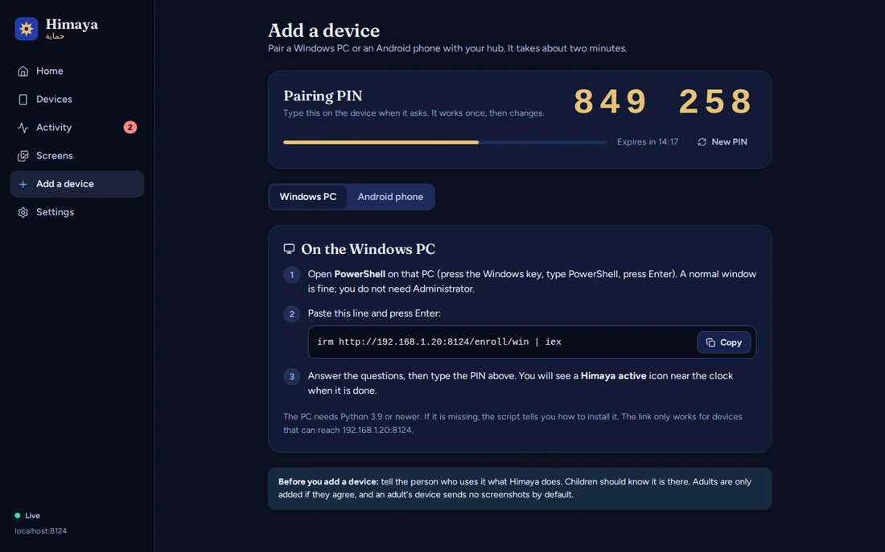
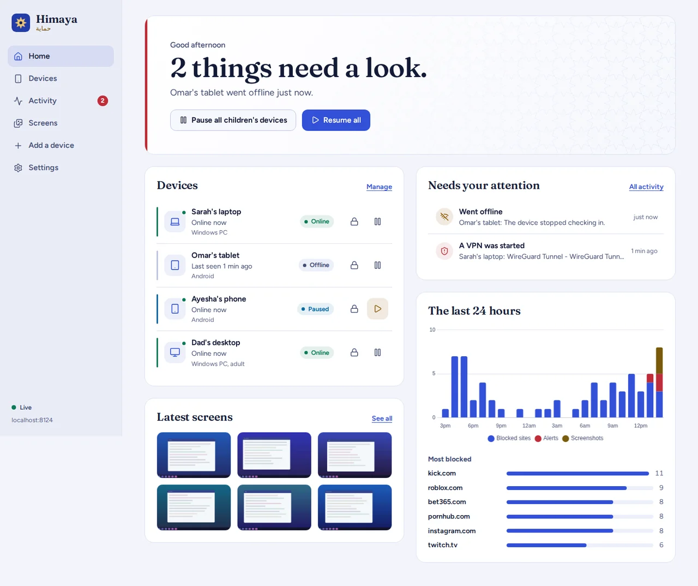
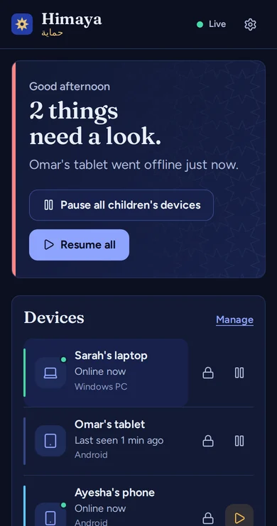

# Himaya

**Family device safety, run from a computer you own.**
One dashboard to see whether your family's devices are okay, and to act in one tap: lock a screen, pause the internet, send a message, change what is blocked.



Himaya (حماية, "protection") is built on four rules. They are not marketing: each one is enforced in code (see [How the rules are kept](#how-the-rules-are-kept)).

1. **Visible, not hidden.** Every device shows a persistent "Himaya active" indicator. There is no stealth mode.
2. **Local-first.** The hub runs on hardware you own. Screenshots and activity stay on it.
3. **Consent for adults.** Adults are enrolled only if they agree, and an adult's device sends no screenshots by default.
4. **Log events, not content.** It stores what happened (a blocked site, a VPN starting, when a device went quiet), never keystrokes, messages or calls.

## What you get

| | Windows PC | Android phone |
| --- | --- | --- |
| Online / "went dark" alerts | Yes | Yes |
| Lock screen | Yes (re-locks every few seconds, so signing back in does not help) | Yes (needs Device admin) |
| Pause internet, bedtime | Yes, through the Windows proxy setting: browsers and most apps | Yes, through the hub's DNS filter (a DNS-only VPN, so the phone's internet is never routed through the hub) |
| Block websites by category or by name | Yes, in the hosts file (needs Administrator) and/or by using the hub as DNS | Yes, through the hub's DNS filter |
| Send a message to the screen | Yes | Yes |
| Close an app | Yes | Background apps |
| VPN alerts | Yes | Yes |
| Screenshots | Every N minutes (child PCs; off by default for adults) | On request only, and the child must approve each one: Android does not allow silent capture |
| Erase a lost device | No | Yes (typed confirmation, needs Device admin) |

The dashboard (a web app you can add to your phone's home screen) shows all of this live, keeps an activity timeline, and has a rules editor per device. The hub also runs a small **DNS filter** (UDP) that enforces each device's rules for any device that uses it.

<table>
<tr>
<td width="50%"></td>
<td width="50%"></td>
</tr>
<tr>
<td></td>
<td></td>
</tr>
</table>

## Quick start

You need Python 3.10 or newer on the computer that will be the hub (a spare PC, a laptop that stays on, a Raspberry Pi).

### 1. Start the hub

**Windows:** double-click `hub\start_hub.bat`. The first run installs its requirements.

**Linux, macOS, Raspberry Pi:**

```bash
cd hub
pip install -r requirements.txt
python main.py
```

**Docker:** `docker compose up -d --build` (see [docs/DEPLOY.md](docs/DEPLOY.md)).

The first start prints an **admin key** once and saves it to `hub/data/admin_key.txt`. Windows may ask to allow Python on private networks: allow it, so devices on your Wi-Fi can reach the hub.

### 2. Sign in

Open `http://localhost:8000` on the hub computer (or `http://<hub-ip>:8000` from your phone) and paste the admin key.

### 3. Add a device

Open **Add a device**. It shows a one-time 6-digit PIN and the steps:

* **Windows PC:** paste the one line shown into PowerShell on that PC. It explains what will be installed, asks for consent, asks for the PIN, then shows a Himaya icon near the clock.
* **Android phone:** build and install the app from [`himaya-mobile`](docs/ANDROID.md), scan the QR code, confirm the hub address, type the PIN.

Each device then appears on the Home screen within seconds.

## How it fits together

```
   Parent (browser / phone)                    Children's devices
   ┌────────────────────┐   X-API-Key          ┌──────────────────────┐
   │ Dashboard (React)  │──── REST + WebSocket ─┤ Windows agent (Py)   │
   └────────────────────┘          │            │ Android app (Kotlin) │
                                   ▼            └─────────┬────────────┘
                         ┌──────────────────┐             │ per-device key
                         │ Hub (FastAPI)    │◄────────────┘ heartbeat, commands,
                         │  SQLite/Postgres │                reports, screenshots
                         │  rules + state   │
                         │  DNS filter :5300│◄── DNS lookups from devices that use the hub
                         └──────────────────┘
```

* The parent state (**locked**, **paused**, bedtime) lives on the hub. Agents receive it in every heartbeat and enforce it, so a missed command cannot leave a device out of step.
* One-off commands (message, screenshot request, close app, erase) go through a queue that hands each command out exactly once.
* Away from home (HTTPS or WireGuard): [docs/REMOTE-ACCESS.md](docs/REMOTE-ACCESS.md). What each tamper-resistance level stops: [docs/TAMPER-RESISTANCE.md](docs/TAMPER-RESISTANCE.md).
* Details of every endpoint: [docs/API.md](docs/API.md). Threat model and credentials: [docs/SECURITY.md](docs/SECURITY.md).

## How the rules are kept

| Rule | Where it is enforced |
| --- | --- |
| Visible | The Windows agent will not run without a visible indicator (the tray icon, or a small window if the tray is unavailable). It has no hidden mode and no Quit entry, and the installer uses no hidden windows or `.vbs` launcher. These are asserted by tests. The Android agent is a foreground service with a permanent notification. |
| Local-first | Activity and screenshots stay on the hub. The hub's only outbound traffic is the DNS lookups it forwards to the resolver you choose (Cloudflare's family resolver by default, `HIMAYA_DNS_UPSTREAM`), the optional keep-alive on free cloud hosts, and a public-IP lookup that is off by default. |
| Consent | The Windows installer asks "Does the person who uses this computer know about this? Type YES". Adults get no screenshots and no default blocks. Android shows its own capture dialog every time. |
| Events, not content | There is no code path for keystrokes, microphone, camera or message content. Screenshots are the one content type, and they are opt-in per device, stored only on the hub, and deleted after a week by default. |

## Honest limits

Read these before relying on Himaya.

* **Tamper-evident by default; hardening is opt-in** (see [docs/TAMPER-RESISTANCE.md](docs/TAMPER-RESISTANCE.md)). **Tamper-evident, not tamper-proof.** A child with an unrestricted Windows account can stop the Python agent in Task Manager. The parent is alerted when the device goes quiet. For stricter control use a standard (non-admin) child account, or Android Device Owner mode.
* **Windows internet pause** uses the per-user proxy setting. It covers browsers and most apps, not everything. Pointing the PC's DNS at the hub is stricter (run the hub's DNS on port 53, see [docs/DEPLOY.md](docs/DEPLOY.md)).
* **Windows website blocking** through the hosts file needs the agent to run as Administrator. Without it the dashboard says so, and DNS-level blocking still works.
* **Android screenshots** cannot be scheduled silently, by design of Android. Each one needs the child to tap Allow.
* **Strict "Private DNS"** on an Android phone bypasses the DNS filter. Himaya reports a VPN or filter being switched off, but cannot lock that setting without Device Owner mode.
* **Live view** works on **Windows** only: up to two minutes, about one picture a second, announced on the child's screen, never saved. On Android it is not built (each screen capture needs the child's approval and a foreground service); use "Screenshot now".
* The Android app has been type-checked and its protocol and packet code tested against the real hub, but it has not been built with Gradle or run on a phone in this release. Build it in Android Studio and see [docs/ANDROID.md](docs/ANDROID.md).

## Configuration

Every setting is an environment variable (or a line in `hub/.env`; see `hub/.env.example`).

| Variable | Default | Meaning |
| --- | --- | --- |
| `HIMAYA_ADMIN_KEY` | generated | The dashboard key. Set it on cloud hosts so it survives restarts. |
| `PORT` | `8000` | HTTP port. |
| `HIMAYA_DNS_ENABLED` / `HIMAYA_DNS_PORT` | on / `5300` | The DNS filter. Use `53` to serve real DNS. |
| `HIMAYA_DNS_UPSTREAM` | `1.1.1.3` | Where allowed lookups are forwarded. |
| `HIMAYA_PUBLIC_URL` | none | Address devices use away from home. |
| `HIMAYA_TIMEZONE` | this computer's | Time zone for bedtime windows, such as `Asia/Karachi`. |
| `DATABASE_URL` | SQLite file | Optional PostgreSQL or Supabase. |
| `HIMAYA_EVENT_RETENTION_DAYS` / `HIMAYA_SNAPSHOT_RETENTION_DAYS` | `30` / `7` | Automatic clean-up. |

## Repository map

```
hub/             FastAPI hub: API, DNS filter, discovery, storage        (Python)
dashboard/       The parent dashboard (React + TypeScript). Builds into hub/static
agent-windows/   Windows agent: tray indicator, lock, pause, screenshots (Python)
himaya-mobile/   Android agent (Kotlin): pairing, DNS-only VPN, lock, messages
tools/           seed_demo.py (fake data for previews), sync_agent.py, Android contract check
docs/            API, security, deployment, Android, design notes
docker-compose.yml, render.yaml   Deployment
```

The original *Himaya — Build Spec* sits beside this folder, as before.

## Development and tests

```bash
# Hub (133 tests; runs a real DNS server and a real hub)
cd hub && pip install -r requirements-dev.txt && pytest

# Windows agent (38 tests; talks to a real hub in a thread, Windows itself is faked)
cd agent-windows && pytest

# Dashboard (46 unit tests, lint, type-check, and a build into hub/static)
cd dashboard && npm install && npm test && npm run lint && npm run build

# Keep the copy of the agent that the hub serves in step with the source
python tools/sync_agent.py          # --check in CI

# Try the dashboard with fake data (never against a real family's hub)
python tools/seed_demo.py --hub http://localhost:8000 --key <admin key>
```

The hub test suite also runs against PostgreSQL: `HIMAYA_TEST_DATABASE_URL=postgresql://... pytest`.

## Troubleshooting

* **"I lost the admin key."** Run `python main.py --reset-admin-key` in the `hub` folder.
* **A device cannot reach the hub.** Check it is on the same Wi-Fi and that the firewall allows Python on private networks. For Docker, set `HIMAYA_LAN_IP` to the host's address.
* **A paired device shows "removed" or its agent stopped.** The hub forgets keys if its database is erased. Remove the device and add it again with a fresh PIN.
* **Dashboard is blank after an update.** Rebuild it (`npm run build` in `dashboard`) so `hub/static` matches.
* **Windows agent log:** `%LOCALAPPDATA%\HimayaAgent\agent.log`.
